# parse_sdp playground: user manual

The playground at <https://andrewstarks.github.io/parse_sdp/> checks a
Session Description Protocol (SDP) file against RFC 8866, SMPTE ST 2110
(Society of Motion Picture and Television Engineers), and IPMX (Internet
Protocol Media Experience), and cites the specification clause behind
every finding. The page runs the `parse_sdp` library compiled to
WebAssembly. The page does not upload a file, text, or setting to a
server. The only request that the page sends for an input is the request
for a URL that the user gives (see
[Loading an SDP file from a URL](#loading-an-sdp-file-from-a-url)). The page is short and labeled, so this manual is an
orientation rather than a complete reference.

The header names the active engine. "Engine: parse_sdp 1.9.1
(WebAssembly)" means the real library is running. "Engine: mock" means
the WebAssembly module could not be loaded; the page then answers from
recorded fixtures, and findings for unknown inputs are illustrative only.

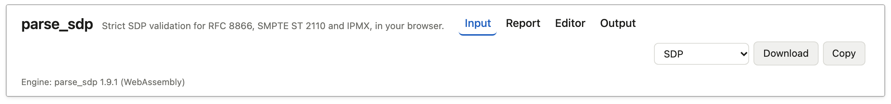


## Input

The Input section accepts three formats. The format is detected from the
first characters of the text.

- SDP text. Text that starts with `v=` is SDP. Text in no other
  recognized format is also treated as SDP, so the parser reports the
  problem instead of the page guessing.
- A JSON document table, in the shape that the library's `to_json`
  produces. Text that starts with `{` or `[` is parsed as JSON.
- A Lua table literal, either `return { ... }` or a bare `{ ... }`. Text
  that starts with `return`, and text that starts with `{` but is not
  valid JSON, is read as Lua.

Text can be pasted into the box, dropped onto the box as a file, opened
with the "Open file…" button, loaded from a URL with the "From URL" box
above the text box, or chosen from the "Examples" dropdown. Each of
those actions runs the analysis at once. Text typed into the box
is analyzed when the "Analyze" button is pressed or when Ctrl+Enter
(Cmd+Enter on macOS) is pressed inside the box. An input that cannot be
read is reported in a banner under the toolbar. A URL that cannot be
loaded is reported in a banner directly under the "From URL" box.

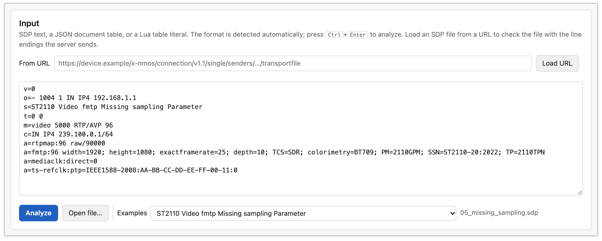

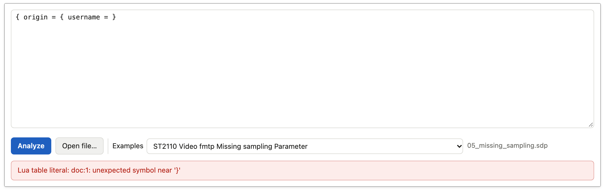

## Loading an SDP file from a URL

Text that is copied from a log or from a device's web page often has
different line endings from the file itself, and the RFC 8866 line-ending
check then reports findings that are not in the file. To check the file
as the server sends it, enter the address of the SDP file in the
"From URL" box and press "Load URL". An example is the IS-05
`transportfile` endpoint of an NMOS (Networked Media Open
Specifications) sender:
`http://192.0.2.10/x-nmos/connection/v1.1/single/senders/<id>/transportfile`.

The page reads the response as bytes, so CRLF line endings and a byte
order mark reach the parser unchanged. The address must start with
`http://` or `https://`. Downloads are named after the last part of the
address path: `.../transportfile` gives `transportfile.sdp`.

The page applies two limits. The page stops a request that has no
complete response after 10 seconds, or after 60 seconds for a
local-network request (see below), because that time includes the
browser's permission prompt. The page does not load a response that is
larger than 1 MB (1,000,000 bytes); an SDP file is typically a few
kilobytes.

### Devices that serve SDP over HTTP

The playground at github.io is an HTTPS page, and most devices serve
their SDP files over `http://`. Browsers block a request from an HTTPS
page to an `http://` address (mixed content), with one exception.
Chrome and Edge 142 and later send the request to a device on the local
network after you allow local network access for the page. The first
time, the browser asks; choose "Allow". The page sends every `http://`
request as a local-network request, so this works for a private IP
address (for example `http://172.16.11.20:3212/...`), a `.local` name,
and a host name that resolves to a local address. Firefox and Safari do
not have this exception and block the request.

If you denied the permission, allow it again in the site settings: click
the icon to the left of the address bar.

The device must also send CORS headers (see the next section). Addresses
on the local machine (`localhost`, `127.0.0.1`, `[::1]`) are not mixed
content in any browser.

### Share link

After a file is loaded from a URL, the page address includes
`?url=<the SDP address>`, and a "Copy link" button copies that address.
Opening the link loads the same SDP address and analyzes the file again,
so another person sees the same report if the server sends the same
file. The link has only the SDP address. Pasted or dropped text is never
put in the page address. When the text in the box is edited, or another
input is loaded, the page removes `?url=` from the address.

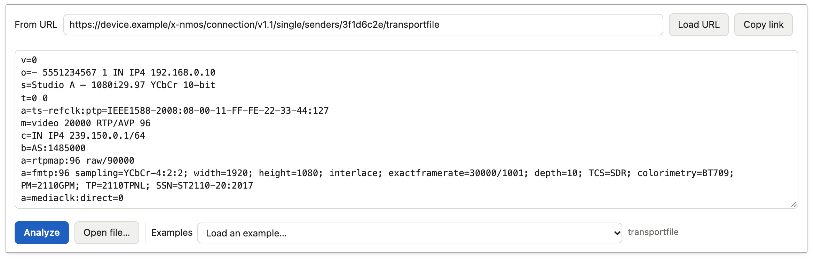

### When the browser cannot load the URL

A browser can block the request for two main reasons. In both cases the
workaround is the same: download the file with the browser and drop it
on the page, or check the file with the command-line tool:

```sh
curl -s '<SDP address>' | parse_sdp validate -
```

- The first reason is cross-origin access control (CORS, Cross-Origin
  Resource Sharing). The browser gives the response to the page only when the server sends an
  `Access-Control-Allow-Origin` header that allows the page's origin.
  Many devices do not send that header. The browser does not tell the
  page why a request failed, so the page reports that "the request was
  blocked or failed" and names CORS as a common reason. A wrong address
  and a server that cannot be reached give the same message.
- The second reason is mixed content: an `http://` address from the
  HTTPS page. A browser other than Chrome or Edge 142 and later blocks
  the request, and Chrome and Edge block it when local network access is
  not allowed or the address is not on the local network. For a failed
  `http://` request, the message lists these reasons together with CORS,
  because the browser does not tell the page which one applies.


## Compliance report

The report shows one card per tier: RFC 8866, ST 2110, and IPMX. Each
card shows Pass or Fail and the number of errors and warnings. Each tier
re-runs every tier below it, so the ST 2110 findings include the RFC 8866
findings, and the IPMX findings include both. A finding that several
tiers report is listed once and tagged with each of those tiers.


The findings list can be filtered by tier and by severity. Each row
shows the severity, the check id, the message, the specification
reference, the error code, the tiers, and the location: `line:col` for
a finding on a source line, or a field path such as
`media[0].attributes[fmtp:pt=96]` for a document-level finding. When one
check fires on several lines with the same severity and tiers, the rows
collapse into one row with a line count and a line range; clicking that
row opens a list of line numbers.

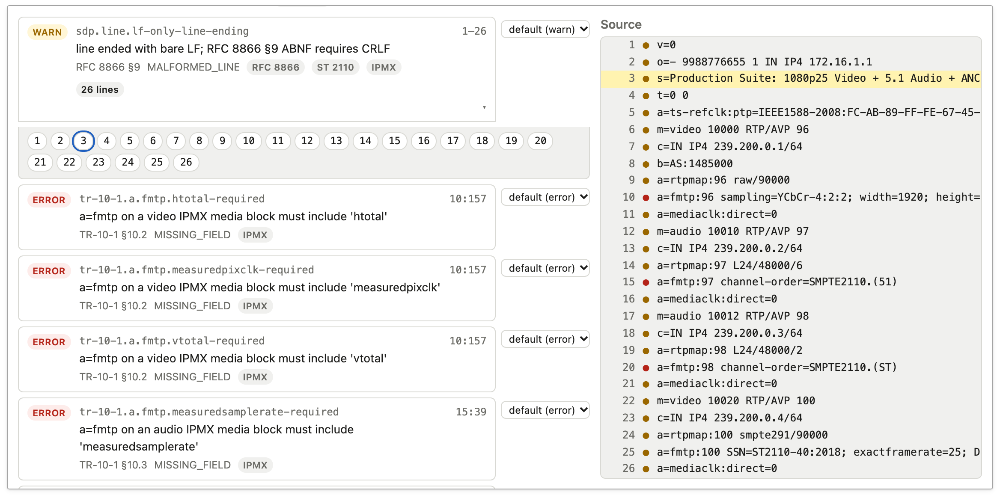

Clicking a finding highlights the line in the Source view next to the
list and scrolls to it. Clicking a document-level finding highlights the
field in the Document editor instead. The Source view numbers every line
of the analyzed text and marks each line that has a finding.


## Policy and severity overrides

The "Policy" button in the report toolbar opens a panel that lists every
check in the registry, grouped by check id prefix, with a severity
selector per check: default, `error`, `warn`, or `off`. The filter box
narrows the list by check id, specification reference, or message text.
"Reset overrides" removes every override. Each finding row in the
report, and each finding disclosure in the editor, has the same selector.

Overrides are stored in the browser (in `localStorage`) and apply to
every analysis until they are reset. Every change re-runs the current
analysis. The "Policy" button shows the number of active overrides, and
a notice in the toolbar shows how many checks are set to `off`.
Hard-syntactic checks define whether the text can be parsed at all;
their severity cannot be changed, and the panel shows them as "fixed".


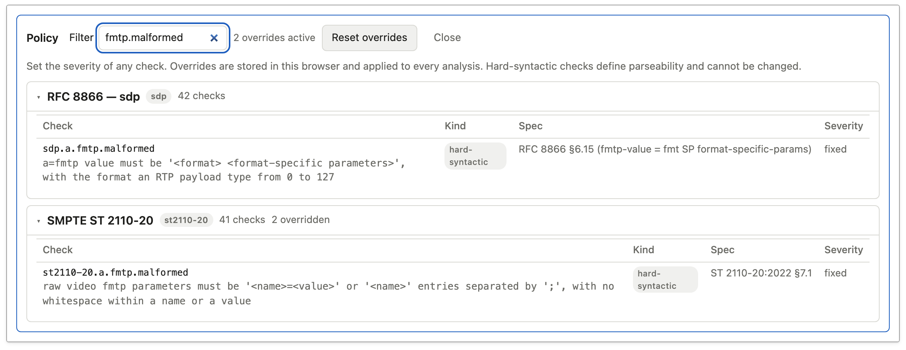

## Document editor

The editor shows the parsed document as nested cards: `origin`,
`session`, each `media` block, and each attribute. Fields are edited in
place. A number field keeps its number type, and a cleared field is
removed from the document. Lists have move, duplicate, and remove
controls, an "Add attribute" selector with templates, and an "Add field"
form. `fmtp` parameters are edited as ordered key and value rows; a
parameter with the "flag" box checked has no value.

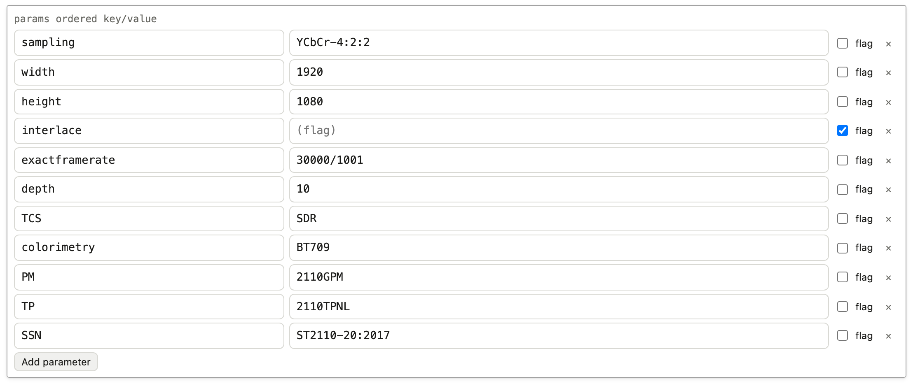

Validation runs after every change: the document is serialized to SDP
text, analyzed again at all three tiers, and the report and the output
are refreshed. Findings are also shown inside the editor:

- A summary block at the top lists every finding, errors first. Clicking
  an entry opens the cards around the field and scrolls to it. The block
  can be collapsed, and that state is remembered in the browser.

  ![The findings summary block at the top of the editor: "5 errors", a Collapse button, and one row per finding with the check id, the message, and a link to the field path such as media[0].attributes[fmtp:pt=96]](manual/img/editor-summary.png)
- Each card shows a badge with its error and warning counts and an
  "Expand findings" button. Each field with a finding is highlighted and
  has a disclosure under it that opens to the full message, the
  specification reference, the location, and a severity selector.

  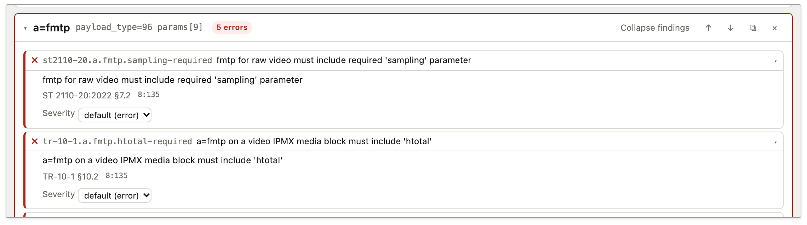
- A finding about a field that does not exist, such as a required `fmtp`
  attribute that is absent, is pinned to the nearest existing container
  with a "missing" badge and the path where the field is expected.

  ![Findings for an absent a=fmtp attribute, pinned to the media block's attributes list. Each has a "missing" badge, for example st2110-20.a.fmtp.PM-required, and the text "expected at media[0].attributes[fmtp:pt=96]"](manual/img/editor-missing.png)
- A finding reported on a source line is shown on the field that line
  produced, with a "line N" badge. Per-line formatting findings stay in
  the Source view only.

  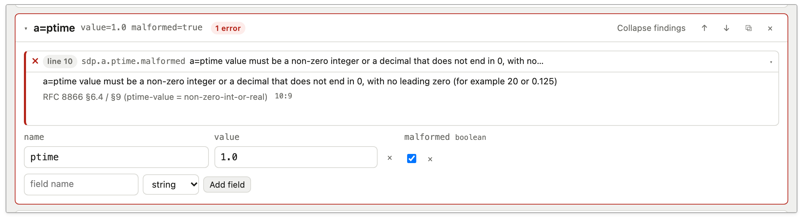

When the document cannot be serialized, for example because a required
field such as `media[1].port` was removed, a "Cannot serialize" banner
names the field, the field is highlighted, and the report is marked
stale until the field is restored.

![The m=video card after its port field was removed: a "cannot serialize" finding says "missing required field media[0].port", and the port field is absent from the media and proto row](manual/img/serialize-error.png)

![The compliance report heading with the status "Report is stale: cannot serialize: missing required field media[0].port (media[0].port)" above the tier cards](manual/img/report-stale.png)

## Output

The sticky bar at the top of the page has a format selector (SDP, JSON,
Lua table literal), a "Download" button, and a "Copy" button. The
download is named after the input file or the last part of the URL
path, with the extension `.sdp`,
`.json`, or `.lua`. The Output section at the bottom of the page has the
same selector and a Copy button, and shows the rendered text with line
numbers.

The SDP output uses CRLF (carriage return and line feed) line endings
and RFC 8866 field order. After an edit, the SDP view shows a line diff
against the document as it was first parsed: added lines are marked `+`,
removed lines are marked `−`, and the status line counts them. The JSON
and Lua views show the current document without a diff. Both are
accepted back as input.

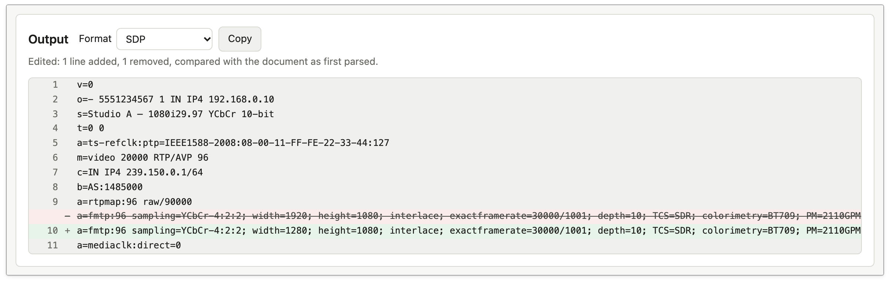

## Examples

The "Examples" dropdown lists every `.sdp` file in the repository's
`examples/` directory, grouped by tier and by whether the file is valid
or invalid at that tier. Each entry is titled by the file's own `s=`
session name line; a file without an `s=` line is titled by its file name.

## Keyboard

- Ctrl+Enter (Cmd+Enter on macOS) inside the input box runs the analysis.
- Escape closes the Policy panel and the section menu on narrow screens.

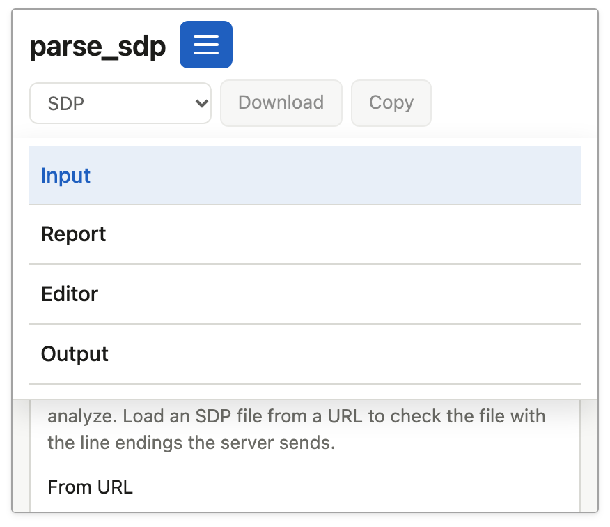

## Limitations

- Line endings. A pasted or dropped file keeps its CRLF line endings
  until the text in the box is edited. After an edit, the browser's text
  box supplies LF line endings, and the RFC 8866 check for CRLF then
  reports every line. To keep CRLF, edit the document in the editor
  instead of the input box, or load the file again. Text that a browser
  or another program changed before it was pasted cannot be recovered.
  To check those line endings, load the file from its URL or drop the
  file on the page. When the report has an LF-only line-ending finding
  for pasted or typed text, a note under the box says so. "Turn off
  warning" sets the check `sdp.line.lf-only-line-ending` to `off` in the
  policy, so the report no longer lists those warnings; "Reset
  overrides" in the Policy panel turns the check on again. "Don't show
  again" hides the note in this browser and leaves the warnings in the
  report.

  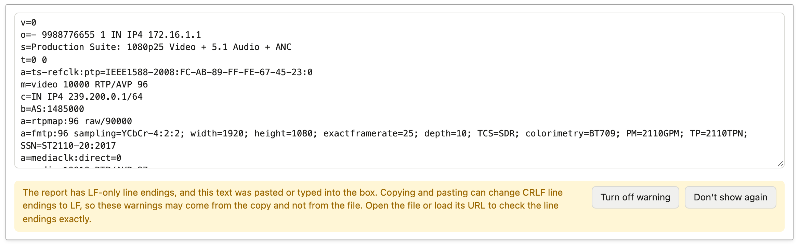
- Everything is client-side. Overrides, the summary block's collapsed
  state, and a dismissed line-ending note are stored in the browser's `localStorage` and are not shared
  between browsers or devices.
- Speed. Measured natively, parsing the largest example file (2835
  bytes) at the IPMX tier takes 0.30 ms on Lua 5.5.0 on the author's
  machine (mean of 200 runs). The browser timing has not been measured;
  the expectation that a typical file parses in milliseconds in the
  browser is inferred from the native figure.
